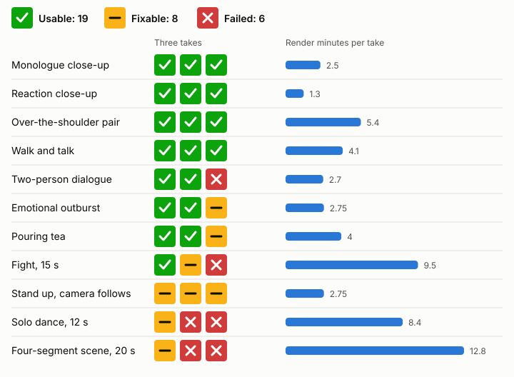
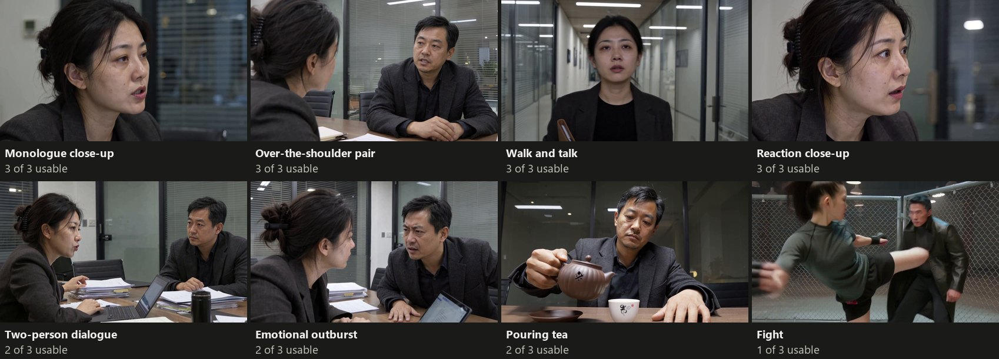
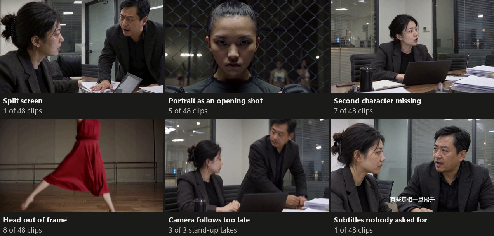
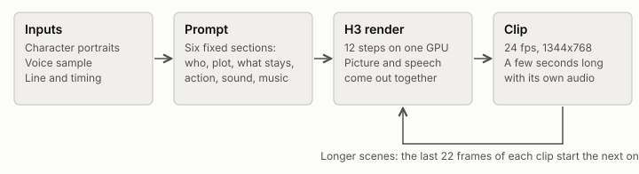

# What MiniMax-H3 can shoot

<p align="center">
  
</p>
<p align="center"><sub>Four moments from the test renders, without sound. All footage here is machine-generated with MiniMax-H3.
<a href="#watch-the-reel">Watch the 85-second reel with sound.</a></sub></p>

MiniMax-H3 is an open-weight model that generates picture and speech in one pass. A public workflow,
[colab-ultra-workstation](https://github.com/yuanyang749/colab-ultra-workstation), says it can shoot short drama on one
rented GPU, with framing that stays locked and lines that land on exact timestamps.

I reran that workflow on 10 scene types and on the author's own four-segment scene, three takes each, with no retakes.
Of the 33 takes, 19 were usable as rendered, 8 needed one fix and 6 failed. H3 acts a single shot well. It follows
precise direction much less well.

This was a two-day project on rented cloud GPUs. Claude Code wrote the code and ran the renders, GPT-6 rated every take
from grids of still frames, and I chose the tests and reviewed the results. Three takes per scene is a small sample, so read the
counts as a first look. Nobody has rated the voices or the lip sync yet.

## Watch the reel

The reel runs 85 seconds with sound. It shows the best take of each scene type, labelled with its rating, and ends on the
split screen described below. If the player does not load, [open the file](media/h3-scene-reel.mp4).

https://github.com/user-attachments/assets/0fa5f08c-61b2-4fe3-a9a0-7cc1779ab965

## Results by scene

<p align="center">
  <picture>
    <source media="(prefers-color-scheme: dark)" srcset="figures/scene-results-dark.svg">
    
  </picture>
</p>

A take is one render with one random seed. Usable means a viewer would accept the shot in a short drama as rendered,
small trims allowed. Fixable means one defect that a partial re-render, a trim or a prompt change would likely solve.
Failed means the shot does not do what the scene needs.

Close-ups, reverse pairs and walking shots held in all three takes. Scenes struggled when a body had to move through
the frame, or when one composition had to last 20 seconds. Those scenes also render slowest, so the failures cost the
most.

| Scene | Usable | Fixable | Failed | Minutes per take | Main reason |
|---|---:|---:|---:|---:|---|
| Monologue close-up | 3 | 0 | 0 | 2.5 | Convincing, with tight crops at the crown of the head |
| Reaction close-up | 3 | 0 | 0 | 1.3 | Surprise reads clearly |
| Over-the-shoulder pair | 3 | 0 | 0 | 5.4 | Characters and sides hold across both clips |
| Walk and talk | 3 | 0 | 0 | 4.1 | Continuous, with some bobbing |
| Two-person dialogue | 2 | 0 | 1 | 2.7 | One take drops a character |
| Emotional outburst | 2 | 1 | 0 | 2.75 | One take adds its own subtitles |
| Pouring tea | 2 | 1 | 0 | 4.0 | One take crops the face |
| Fight, 15 s | 1 | 1 | 1 | 9.5 | The join is good, but one second half goes stiff |
| Stand up, camera follows | 0 | 3 | 0 | 2.75 | The head reaches the top edge before the camera moves |
| Solo dance, 12 s | 0 | 1 | 2 | 8.4 | Framing loses the choreography |
| Four-segment scene, 20 s | 0 | 1 | 2 | 12.8 | The promised continuous two-shot never holds |

[`docs/scenes.md`](docs/scenes.md) says what each scene asked for. [`docs/ratings.md`](docs/ratings.md) has the full
review, take by take.

## What worked



In the best takes, skin has visible pores and the light looks like an ordinary office. Faces stayed recognizable, and no
take swapped or cloned a character or flipped left and right. GPT-6 ranked restrained dialogue, reactions and tea pouring
as the strongest results.

## Claims against measurements

| The workflow says | Result | What I measured |
|---|---|---|
| A 20 s four-segment scene renders in about 12.5 min | Held | 12.75 to 12.85 min in all three takes, before finishing passes |
| No haze or grey wash late in a scene | Held | Contrast and detail stayed in all three four-segment takes |
| Characters keep their faces and sides | Held | No swaps or mirror flips in 48 clips; one fight drifts in the man's face and coat |
| Joins between fight clips do not show | Held | Boundary frames matched in all three fights |
| Each line is spoken once, as written | Held | Whisper transcripts of the four-segment scene had each line once, with no script hint |
| Shouted lines rise by about 8 dB | Partly | Four-segment scene: men +4.8 to +7.5 dB, women +1.6 to +3.8 dB, measured on the whole track |
| One two-shot holds across all four segments | Failed | All three takes change the composition |
| A head stays in frame when a character stands | Failed | All three takes cross the top edge during the rise |
| Full body stays visible in fights and dance | Failed | All 6 fight clips hide the feet for long stretches; all 3 dances crop key movement |
| Fight action starts on the first frame | Failed | All 3 fights open on a reference portrait |
| Lines finish inside their time window | Failed | 34 of 36 dialogue clips missed, 32 by ending late, from word timestamps |
| A 90-frame clip samples in 50 to 65 s | Failed here | 78 s in all three takes, on a Colab G4 with an RTX PRO 6000 |
| A 90-degree profile holds to the end of a segment | Unclear | Head angle varied in all three takes, but my port of that lock lost two settings |
| Voices stay the same, lips match, hits land on sound | Not judged | Nobody has rated the audio |

## How the takes failed



H3 often edits on its own. Nine clips contain a hard cut nobody asked for, and five of those open on a reference
portrait held for a second or so before cutting into the scene. A trim removes a portrait opening. Cuts inside a take
are harder, because some read as editing and others break continuity.

Framing drifts when bodies move up and down. Eight clips crop a head or upper body badly, six of them in the stand-up and
dance scenes. That count leaves out ordinary tight crops in close-ups.

GPT-6 passed the split screen, even though it was told to look for one. I noticed it while watching the reel, and that
moved the take from fixable to failed. A scan for a fixed vertical line ([`scripts/split_scan.py`](scripts/split_scan.py))
flagged three clips, and the other two were real door frames. Stills at two frames per second can miss what playback shows.

My read is that H3 suits a shoot-many-and-select approach better than a shot list: render several takes and cut between
them. I have not tested that.

## Limits of this test

- Three takes describe these renders. They give no success rate for another seed, cast or prompt.
- Nine of the 11 scene types use the same two characters, so a defect or a strength may belong to them.
- One reviewer rated the picture from frames. Nobody rated the audio, and whole-track volume says little about a voice.
- The four-segment scene locks one clip to a target frame. The author's graph uses an older version of that node. The
  current one has no strength setting and works differently, so my port only approximates it. That affects the
  profile row above.
- Prompts and seeds were fixed before the run, and nothing was tuned or retaken.

## How a render works

<p align="center">
  <picture>
    <source media="(prefers-color-scheme: dark)" srcset="figures/pipeline-dark.svg">
    
  </picture>
</p>

I used the components the workflow recommends. The exact downloads and revisions are in
[`scripts/setup_box.sh`](scripts/setup_box.sh).

| Part | Choice |
|---|---|
| Video model | Singularity v1.3 pruned int8, a community build of MiniMax-H3 |
| Text encoder | Qwen3-VL-32B Heretic, NVFP4 |
| Add-on weights (LoRAs) | Realism 0.75, facial close-up 0.50 (0.15 for action), turbo 8-step 0.75 |
| Conditioning | BUNNY V2 bridge, 0.10 for dialogue and 0.22 for action |
| Conditioning | BUNNY V2 bridge, 0.10 for dialogue and 0.22 for action |
| Sampling | 12 steps of `res_multistep` |
| Runtime | ComfyUI 0.43.2 with ComfyUI-H3-Motion-Context 0.7.1 |

## Cost and interruptions

The scene test used 178 GPU minutes on three Colab G4 machines running side by side. That came to about 45 Colab compute
units and 70 minutes of wall-clock time. A G4 bills 10.05 units an hour, and a 5-second clip takes about 2.5 minutes and
peaks near 74 GB of GPU memory.

Colab can take a GPU back without warning, so I killed a machine on purpose in the middle of a render. A replacement was
set up and restored 342 seconds later, a time that includes one bug fix made during the test. Only the half-rendered
segment was lost. Each machine also releases itself at a deadline, so a hung job cannot keep spending credits.

## The story builder

`make.py` is a separate tool from the scene test. It turns one story file, such as
[`stories/ferry.json`](stories/ferry.json), into a finished video with captions, nameplates and a title. The 20-second
ferry story took 19.6 GPU minutes on the official H3 weights.

Every step is cached by a hash of its inputs and code. Changing a title took 2 seconds and no GPU time, and changing the
last line re-rendered one segment in 3.9 GPU minutes. Captions bind to words in the script, so they move when a line
changes.

I took these ideas from [Hypit](https://github.com/hypit-ai/hypit) and wrote them again here: rebuilds driven by a
dependency graph, timing anchored to words, code-rendered text layers, a genre playbook with checks before any render,
and review from frame grids. I did not carry over its reference-video cloning, B-roll, sound effects or batch variants.

The builder's latest automatic checks have not been through a full story yet. One run stopped at its first segment, as
designed, and I cut the next one short to start the scene test.

## Run it

You need a GPU with about 74 GB of memory. On Colab, `scripts/bringup.sh` starts a machine with its deadline set
and `scripts/setup_box.sh` installs everything.

```sh
python make.py stories/ferry.json --plan              # what would run and what it would cost
python make.py stories/ferry.json --name ferry        # build
python make.py stories/ferry.json --name ferry2 --set segments.3.line=...   # one change, the rest reused
```

The tests need no GPU:

```sh
uv run --no-project --with pytest --with numpy python -m pytest -q tests
```

This repo does not include the scene test's prompts or the portraits it used. Most of the prompt text is the author's,
and their repository has no license, so I link to it instead of copying it. Without those files, the tests for the scene
runner skip themselves and `scripts/start_workers.sh` cannot run.

## What I would do next

Rate voices and lip sync first, since half of what H3 offers is sound. Then render more takes of the strong scenes with
new casts, to see whether "3 of 3" survives a change of faces, and try cutting a short scene from several takes.

## License and disclosure

The code is under the [MIT License](LICENSE). That license does not cover `figures/` or `media/`.

Every image and video in this repository is machine-generated with MiniMax-H3, which has its own
[community license](https://huggingface.co/MiniMaxAI/MiniMax-H3/blob/main/LICENSE). The characters are fictional. The two
office characters come from the sample portraits in colab-ultra-workstation. The fighters and the dancer were generated
for this test.
